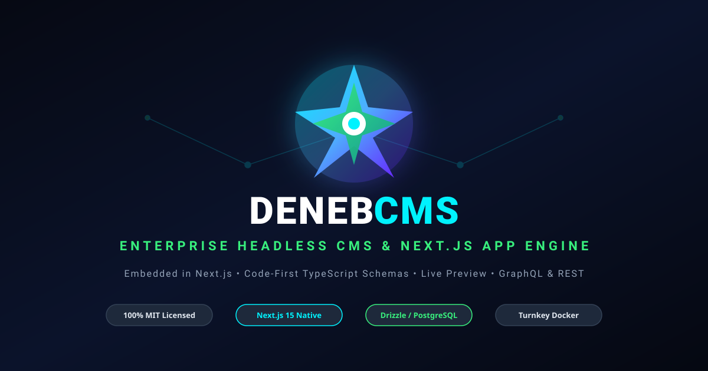

<p align="center">
  <picture>
    <source media="(prefers-color-scheme: dark)" srcset="public/brand/deneb-banner.svg">
    <source media="(prefers-color-scheme: light)" srcset="public/brand/deneb-banner.svg">
    
  </picture>
</p>

<p align="center">
  <a href="https://github.com/wtfear/DenebCMS/actions/workflows/ci.yml">
    
  </a>
  <a href="https://opensource.org/licenses/MIT">
    
  </a>
  <a href="https://nextjs.org">
    
  </a>
  <a href="https://typescriptlang.org">
    
  </a>
  <a href="https://docker.com">
    
  </a>
</p>

<h1 align="center">DenebCMS</h1>

<p align="center">
  <strong>Enterprise Headless CMS &amp; Sovereign Next.js Application Engine</strong><br>
  <em>Engineered for Agencies, Brand Portals, and Enterprise Marketing Stacks by WTFear Agency</em>
</p>

---

## 🏛️ Executive Summary

**DenebCMS** is an institutional-grade, 100% MIT-licensed Headless Content Management System and full-stack application engine built natively on **Next.js 15**, **TypeScript**, and **PostgreSQL** (via Drizzle ORM). 

Unlike legacy headless CMS platforms (Contentful, Sanity, or Strapi Cloud) that penalize agency clients with restrictive content-type caps, traffic taxes, and recurring monthly SaaS invoices, DenebCMS embeds directly inside your Next.js application root. The admin panel and frontend live together in one unified codebase, running entirely on your client's sovereign infrastructure.

### The Agency Commercial Advantage ($25k – $75k+ Engagements)
* **Single Codebase Simplicity:** No separate backend microservice to host; the CMS admin UI runs natively in Next.js Server Components.
* **Code-First Schema Definition:** Schemas are defined in pure TypeScript with instant autocomplete and zero UI-schema sync drift.
* **Enterprise Live Preview:** Real-time side-by-side editing previews with responsive viewport toggles for desktop, tablet, and mobile.
* **Zero License Taxes:** 100% pure MIT license with no copyleft clauses, giving your agency complete freedom to white-label.

---

## ⚡ Core Architecture & Capabilities

```
                       ┌───────────────────────────────┐
                       │     DENEB CMS CORE            │
                       │   (Next.js 15 App Router)     │
                       └──────────────┬────────────────┘
                                      │
       ┌──────────────────┬───────────┴───────────┬──────────────────┐
       ▼                  ▼                       ▼                  ▼
┌──────────────┐   ┌──────────────┐        ┌──────────────┐   ┌──────────────┐
│  ADMIN PANEL │   │ CODE SCHEMAS │        │ DUAL ENGINE  │   │ MEDIA VAULT  │
│  • React 19  │   │ • TypeScript │        │  • GraphQL   │   │  • S3 / R2   │
│  • RBAC ACL  │   │ • Drizzle    │        │  • REST API  │   │  • Local     │
│  • Live View │   │ • PostgreSQL │        │  • Lexical   │   │  • CDN Cache │
└──────────────┘   └──────────────┘        └──────────────┘   └──────────────┘
```

### 1. Embedded Next.js 15 Engine
Run both your marketing website/web app and the CMS administration panel in one container. Enjoy server actions, React 19, and sub-millisecond edge caching.

### 2. Dual API Generation (GraphQL + REST)
Every TypeScript collection defined in DenebCMS automatically generates both full-featured RESTful endpoints and high-performance GraphQL queries with pagination, filtering, and sorting.

### 3. Lexical Rich Text Editor
Extensible block-based editor supporting custom React component blocks, relationship embeds, markdown shortcuts, and multi-lingual localization.

---

## 🚀 Quick Start (Docker Compose)

Deploy DenebCMS with PostgreSQL in seconds:

```bash
# 1. Clone repository
git clone https://github.com/wtfear/DenebCMS.git
cd DenebCMS

# 2. Configure environment
cp .env.example .env

# 3. Launch stack
docker compose up -d
```

Access the admin dashboard at [http://localhost:3000/admin](http://localhost:3000/admin).

---

## 📜 License

DenebCMS is open-source software licensed under the **[MIT License](LICENSE)**.
